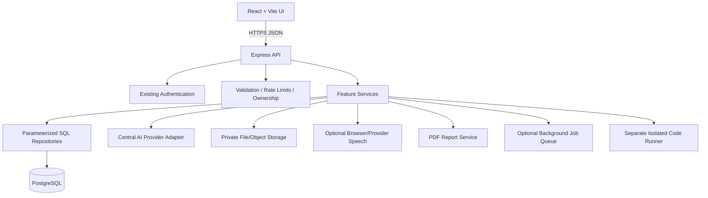
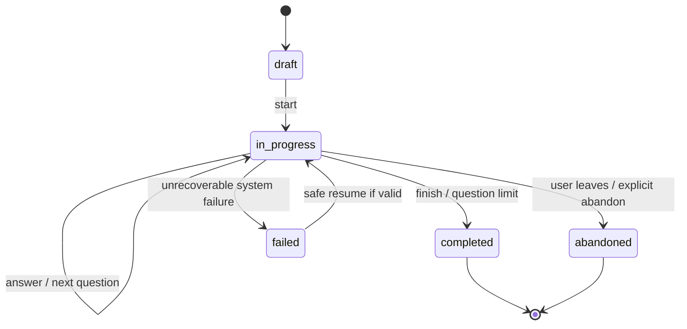

# 02 — Architecture and Data Flows

## 1. Target architecture

This is a target architecture, not proof that all components exist. Keep the current modular structure if it is already reasonable.

## 2. Layer responsibilities

### Frontend
- Reuse current router, API client, auth provider and UI conventions.
- Keep business-critical validation on the server; frontend validation is for user experience.
- Use a shared design system and typed/validated API response handling where the existing stack allows.
- Do not place AI-provider keys, database credentials or runner secrets in Vite variables.
- Use route-level code splitting for heavy screens where useful.

### Express API
- Authentication and authorization.
- Request validation, upload limits, rate limits and request IDs.
- Consistent success/error responses.
- Feature orchestration; no raw arbitrary SQL in route handlers.
- No execution of user-submitted source code.

### Services and repositories
- Services contain business rules and provider orchestration.
- Repositories use parameterized SQL and explicit transactions.
- AI provider adapter centralizes model, timeout, token limits, retries, response schemas and usage accounting.
- External provider calls must have bounded timeouts and error mapping.

### PostgreSQL
- Source of truth for users, session state, evaluations, analytics source data, learning tasks and metadata.
- UTC `TIMESTAMPTZ` timestamps.
- Explicit foreign keys, status constraints and measured indexes.
- Avoid storing large files as public/static assets.

### Private storage
- Use a generated storage key, not a user-provided path.
- Local storage only for local development unless production host persistence is verified.
- Prefer private object storage in production if the host filesystem is ephemeral.
- Verify signed URL expiry and ownership before issuing download access.

### DSA runner
- Separate process/service or vetted sandbox provider.
- No access to app database, cloud metadata, host filesystem or app secrets.
- Network disabled by default, per-job isolation, CPU/memory/time/output limits.
- Runner remains disabled until security and deployment gates pass.

## 3. Suggested services

Adapt to existing folders; do not perform a broad file move just to match names.
- `resumeService`, `resumeParserService`, `resumeMatchingService`
- `jobDescriptionService`
- `interviewService`, `questionGenerationService`, `adaptiveInterviewService`
- `evaluationService`, `analyticsService`
- `codingQuestionService`, `codingSubmissionService`, `codeExecutionService`
- `speechToTextService` (optional)
- `reportService`, `pdfReportService`
- `learningPlanService`
- shared `aiProviderAdapter`, `fileStorageAdapter`, `validationSchemas`, `errorHandler`

## 4. Interview state machine

Suggested states: `draft`, `in_progress`, `completed`, `abandoned`, `failed`.

Rules:
- Define allowed transitions centrally.
- Reject answers to completed/abandoned sessions.
- Use transactions/conditional updates to prevent concurrent advancement.
- Use idempotency keys for answer submissions and report generation where retries are possible.
- Store timestamps for start, last activity and completion.

## 5. Data flows

### Resume match
Upload → extension/MIME/signature/size validation → private storage → parsing → normalized text → structured extraction → compare with job requirements → validate result schema → persist match/version → render evidence and gaps.

### Interview
Create session/config → persist session → generate bounded question → validate/persist question → accept answer → persist answer idempotently → evaluate → validate evaluation → persist → choose follow-up/topic/difficulty → next question or completion.

### DSA
Fetch curated problem → submit source with language allowlist → queue/status response → isolated runner executes with strict limits → bounded result persisted → UI polls status. If runner is absent, disable run/submit execution and clearly explain why.

### Voice
User initiates voice mode → explain processing → request permission → speech-to-text → candidate reviews/corrects transcript → submit through normal answer endpoint. Text entry remains available at all times.

### PDF report
Authorize owner → collect persisted session/evaluations → validate completeness → render PDF using safe text escaping → private storage or controlled stream → ownership check again on download.

### Learning plan
Collect role/availability/gaps → generate structured plan → validate task schema/date bounds → persist plan and items → user edits/completes tasks → regenerate without overwriting completed work.

## 6. Scalability and performance
- Begin with a modular monolith; don't introduce microservices without evidence.
- Paginate history and large lists.
- Add indexes from actual query patterns and verify with query plans.
- Set DB pool limits appropriate to hosting connection limits.
- Apply per-user quotas, provider timeouts and bounded concurrency.
- Use background jobs only when parsing/reporting/AI operations exceed acceptable request latency.
- Cache only safe, non-user-specific data unless cache keys enforce ownership.
- Track latency/error rate/provider usage without logging sensitive payloads.

## 7. Deployment topology
- Frontend static host → HTTPS API host → managed PostgreSQL with restricted network access.
- Use production secret manager/environment settings.
- Verify TLS, CORS, cookie settings, storage persistence, health checks and backups.
- Never configure a deployed backend to use a developer's `localhost` database.
