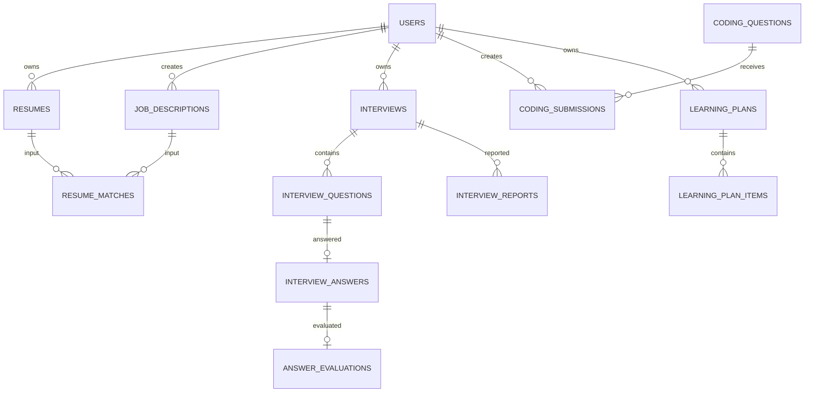

# 03 — PostgreSQL Schema and Safe Migrations

> This is a proposed logical schema. It is not executable migration SQL. Inspect the live repository, existing users table, key types, naming conventions, migrations and data before writing migrations.

## 1. Conventions
- Match the existing primary key type and naming convention.
- Use `TIMESTAMPTZ` and UTC.
- Foreign keys and explicit status/check constraints.
- Parameterized SQL only.
- Use JSONB for versioned AI result payloads where schema flexibility is genuinely useful; keep queryable relationships relational.
- Add indexes for measured access patterns, not every column.
- Define retention and deletion behavior explicitly.
- Never drop/reset existing tables or user data to install features.

## 2. Proposed tables

| Table | Core fields | Purpose |
|---|---|---|
| `resumes` | id, user_id, file_name, storage_key, mime_type, size_bytes, status, parsed_text, extracted_data, created_at, updated_at, deleted_at | Private resume metadata and parse state |
| `job_descriptions` | id, user_id, title, company, description, requirements, created_at, updated_at | Candidate-owned job targets |
| `resume_matches` | id, user_id, resume_id, job_description_id, match_data, scoring_version, model_version, created_at | Versioned matching results |
| `interviews` | id, user_id, resume_id nullable, job_description_id nullable, interview_type, target_role, language, difficulty, status, question_limit, started_at, completed_at, created_at, updated_at | Interview session |
| `interview_questions` | id, interview_id, position, question_text, category, difficulty, metadata, created_at | Ordered questions |
| `interview_answers` | id, question_id, answer_text, transcript, idempotency_key, submitted_at | Candidate responses |
| `answer_evaluations` | id, answer_id, scores, strengths, improvements, ideal_answer, rubric_version, model_version, created_at | Structured feedback |
| `coding_questions` | id, slug, title, statement, difficulty, topics, constraints, examples, starter_code, is_active | Curated DSA catalogue |
| `coding_submissions` | id, interview_id nullable, question_id, user_id, language, source_code, status, runner_reference, created_at, finished_at | Candidate submissions |
| `coding_test_results` | id, submission_id, passed_count, total_count, execution_ms, memory_kb, summary, created_at | Bounded runner results |
| `learning_plans` | id, user_id, source_interview_id nullable, target_role, available_minutes_per_day, start_date, target_date, status, created_at, updated_at | Roadmap metadata |
| `learning_plan_items` | id, plan_id, position, topic, task, estimated_minutes, target_date, status, completed_at | Editable tasks |
| `interview_reports` | id, interview_id, user_id, status, storage_key nullable, summary, created_at, generated_at | Report metadata |
| `ai_usage_events` | id, user_id nullable, feature, provider, model, input_tokens, output_tokens, estimated_cost, status, request_id, created_at | Cost and reliability telemetry |
| `audit_events` (if justified) | id, actor_user_id nullable, action, resource_type, resource_id, request_id, created_at | Minimal security/audit trail |

Do not add every table blindly. Some may already exist under different names; map and reuse existing equivalents.

## 3. Relationships

## 4. Constraints and indexes to evaluate
- Index all high-volume foreign keys used for filtering.
- Unique `(interview_id, position)` for question ordering.
- Unique idempotency key in the appropriate user/session scope.
- Check valid status enums and positive limits.
- Index `(user_id, created_at DESC)` for histories.
- Index `(interview_id, position)` for question retrieval.
- Index `coding_submissions(user_id, created_at DESC)` for submission history.
- Index plan items by `(plan_id, position)`.
- Add indexes only after reviewing actual queries and expected row counts.

## 5. Migration protocol
1. Inspect schema using existing migration tooling and read-only introspection.
2. Back up staging data and confirm restore procedure.
3. Write additive, versioned migration(s) using the repository's migration convention.
4. Prefer expand-and-contract changes: add nullable/new fields first, deploy compatible code, backfill safely, then tighten constraints in a later release.
5. Test on a disposable database with realistic schema and seed data.
6. Verify existing records and authentication remain intact.
7. Apply in staging; verify row counts, constraints and query behavior.
8. Obtain explicit approval before production migration.
9. Keep a documented recovery/forward-fix plan; do not promise rollback if data transformations are irreversible.
10. Never run `DROP SCHEMA`, `DROP TABLE`, `TRUNCATE`, or database reset commands as a shortcut.

## 6. Retention and deletion
- User deletion must follow a defined policy for resumes, reports, answers, transcripts and learning plans.
- Remove private stored files when their database records are deleted, using safe retryable cleanup.
- Avoid cascading deletes until product retention requirements and foreign-key effects are reviewed.
- AI usage events should not contain raw answers, resumes, transcripts or credentials.
