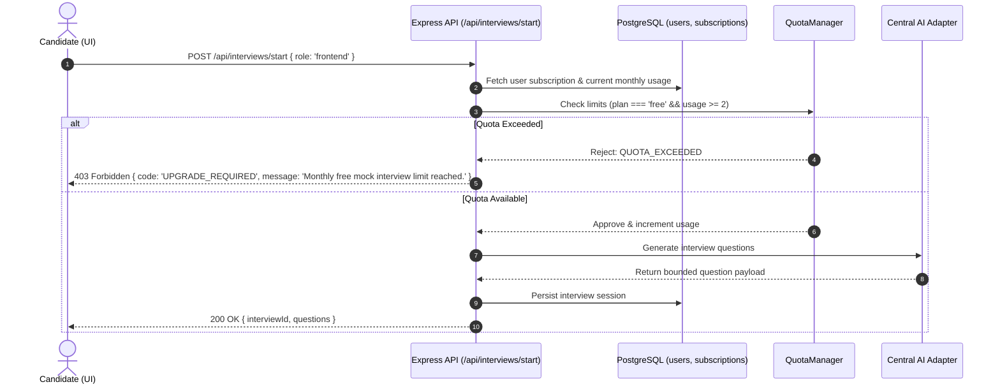

# 08 — SaaS Pricing Tiers, Quota Limits and Billing Architecture

## 1. Commercial SaaS Overview

AI_Interview Simulator is designed as a multi-tier B2C & B2B SaaS platform for technical candidates and engineering hiring teams. This document defines the commercial subscription tiers, usage quotas, token constraints, and billing integration architecture.

---

## 2. Subscription Tiers Matrix

| Dimension | Free Tier ("Starter") | Pro Tier ("Career Pro") | Team / Campus Tier |
|---|---|---|---|
| **Price** | $0 / month | $19 / month (or $149/yr) | Custom / Seat-based |
| **Target User** | Casual practice / Students | Active job seekers | Bootcamps, Universities, Agencies |
| **Mock Interviews** | 2 sessions / month | Unlimited sessions | Unlimited sessions |
| **Questions per Session** | 3 questions max | 5 to 10 questions | Configurable rubrics |
| **Question Types** | Frontend, DSA basics | Full catalogue (System Design, Behavioral, Full Stack) | Custom job question builder |
| **AI Evaluation** | Basic scores & summary | In-depth rubric, category breakdown, ideal sample answers | Team analytics & batch evaluations |
| **Resume Parsing & Matching**| 3 resume uploads / month | Unlimited resumes + multi-job matching | Bulk resume candidate scoring |
| **Voice Mode (Speech)** | Text-only | WebSpeech & AI Voice transcription | Real-time speech & latency tuning |
| **PDF Evaluation Reports** | Screen view only | Instant branded PDF download | White-labeled institutional reports |
| **DSA Code Practice** | 10 practice problems | Full 150+ problem catalogue | Custom coding challenges |
| **Token Limit / Month** | 25,000 AI tokens | 500,000 AI tokens | Tailored enterprise quota |

---

## 3. Server-Side Quota Enforcement

Never trust the client to enforce limits. Every AI generation, interview question, and resume upload must verify user subscription status before invocation:



---

## 4. Proposed Database Schema Additions for SaaS

To support subscriptions without disrupting the existing user model, add versioned additive tables (per `RULES.md` Section 4):

```sql
-- 1. Subscription tracking table
CREATE TABLE IF NOT EXISTS user_subscriptions (
    id UUID PRIMARY KEY DEFAULT gen_random_uuid(),
    user_id UUID NOT NULL REFERENCES users(id) ON DELETE CASCADE,
    tier VARCHAR(50) NOT NULL DEFAULT 'free', -- 'free', 'pro', 'team'
    status VARCHAR(50) NOT NULL DEFAULT 'active', -- 'active', 'past_due', 'canceled', 'trialing'
    provider VARCHAR(50) DEFAULT 'stripe', -- 'stripe', 'razorpay'
    customer_id VARCHAR(255),
    subscription_id VARCHAR(255),
    current_period_start TIMESTAMPTZ NOT NULL DEFAULT NOW(),
    current_period_end TIMESTAMPTZ NOT NULL DEFAULT NOW() + INTERVAL '30 days',
    cancel_at_period_end BOOLEAN DEFAULT FALSE,
    created_at TIMESTAMPTZ NOT NULL DEFAULT NOW(),
    updated_at TIMESTAMPTZ NOT NULL DEFAULT NOW()
);

-- 2. Monthly usage metrics table (resets each billing cycle)
CREATE TABLE IF NOT EXISTS user_usage_quotas (
    id UUID PRIMARY KEY DEFAULT gen_random_uuid(),
    user_id UUID NOT NULL REFERENCES users(id) ON DELETE CASCADE,
    billing_period_start TIMESTAMPTZ NOT NULL,
    interviews_conducted INT DEFAULT 0,
    resumes_uploaded INT DEFAULT 0,
    job_matches_run INT DEFAULT 0,
    ai_tokens_used INT DEFAULT 0,
    pdf_reports_generated INT DEFAULT 0,
    created_at TIMESTAMPTZ NOT NULL DEFAULT NOW(),
    updated_at TIMESTAMPTZ NOT NULL DEFAULT NOW(),
    CONSTRAINT unique_user_period UNIQUE(user_id, billing_period_start)
);
```

---

## 5. Billing & Payment Gateway Integration

### Supported Payment Gateways
- **Stripe**: Recommended for Global / International cards (USD, EUR, GBP) via Stripe Checkout & Customer Portal.
- **Razorpay**: Recommended for domestic Indian currency (INR, UPI, NetBanking).

### Webhook Event Handling Protocol
1. **Signature Verification**: Every webhook request must verify `stripe-signature` or `x-razorpay-signature` using the raw binary request buffer before parsing JSON.
2. **Idempotent Processing**: Webhook event IDs (`event.id`) must be stored in an `idempotency_keys` table to prevent double-crediting subscriptions on retries.
3. **Core Events Supported**:
   - `checkout.session.completed`: Upgrade user tier from `free` to `pro`.
   - `invoice.payment_succeeded`: Extend `current_period_end` by 30 days and reset usage quotas.
   - `customer.subscription.deleted`: Downgrade user back to `free` at the end of the billing period.

---

## 6. Security and Compliance Safeguards

- **No Card Data Storage**: The application server must never process or store raw credit card numbers. All billing forms use Stripe Elements or hosted checkout redirects.
- **Fail-Open vs Fail-Closed**: In case of payment gateway downtime, non-destructive core services remain accessible, but quota bypasses are prevented.
- **Auditing**: Every plan change, invoice, and quota reset is recorded in `audit_events`.
